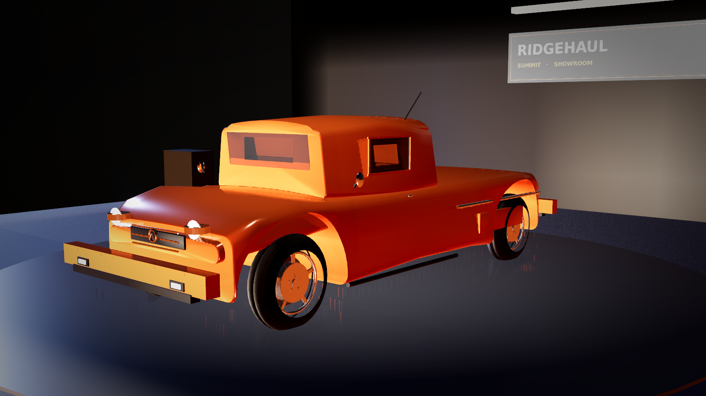
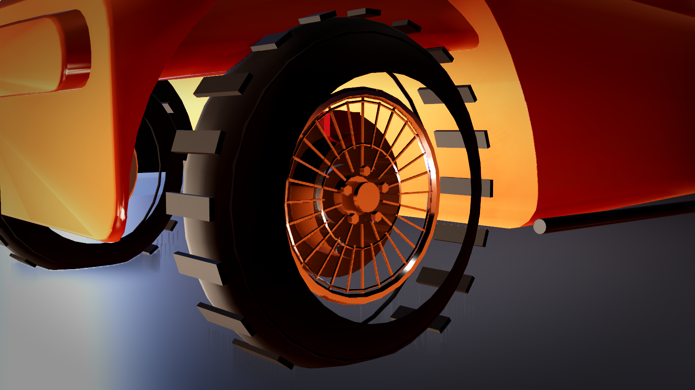
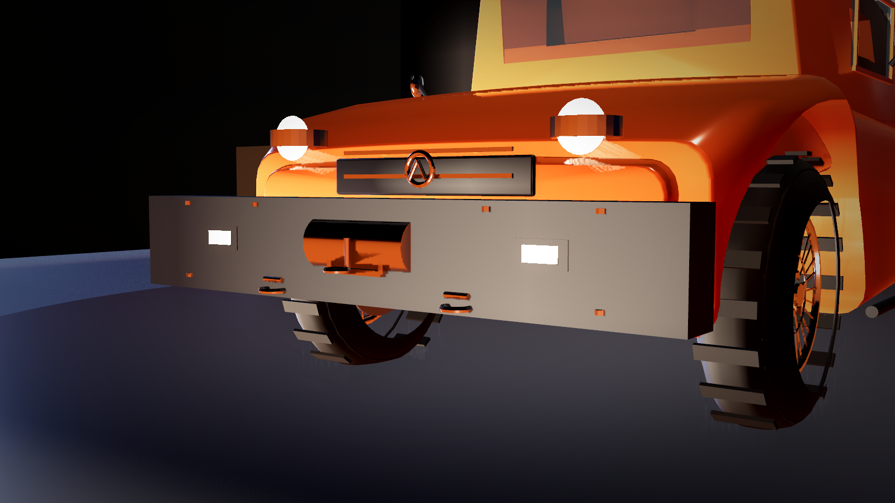
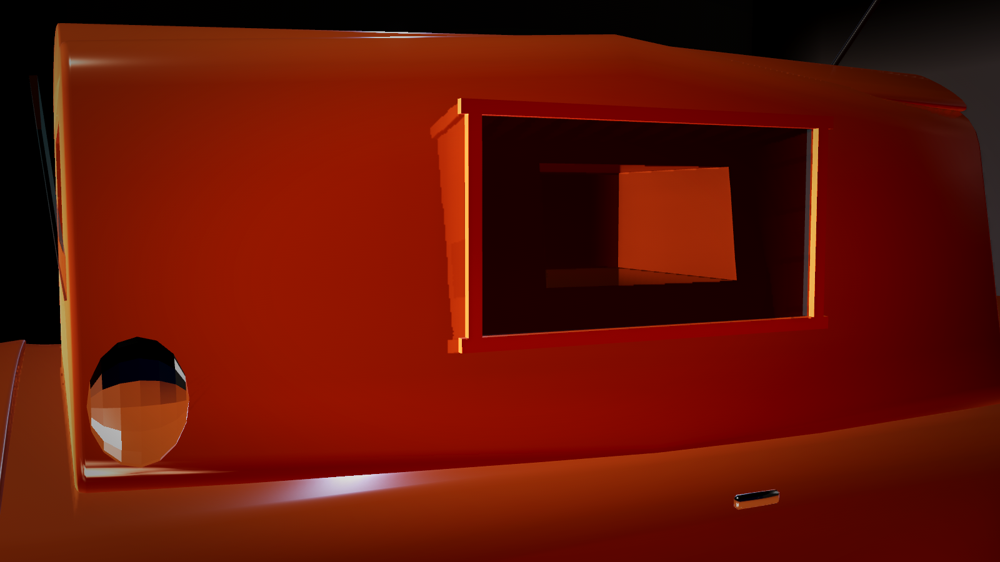
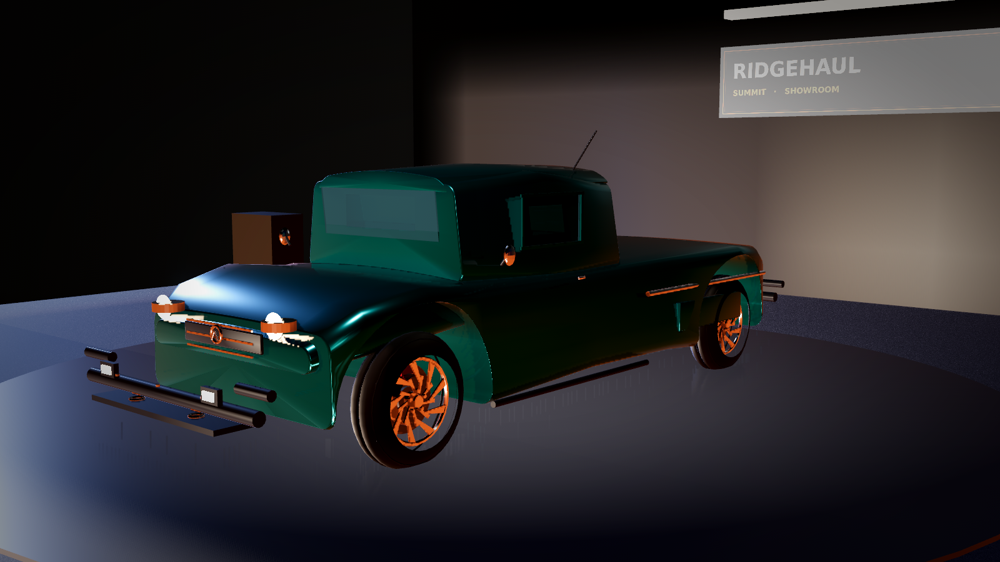
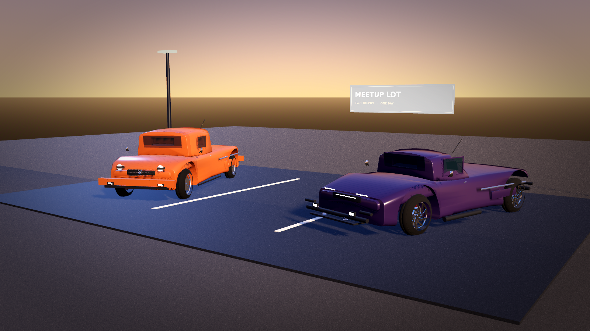

# Engine demos

Two small showrooms of the same Blender trucks, for a look at Godot 4 and Unity 6 before anyone commits to a native multiplayer version. The web app is unchanged.

The trucks are the fictional ones already in the repo: Ridgehaul Summit, Veldt Meridian, Northline Harbor, and Kestrel Talon. Both demos load `src/assets/models` directly (bodies, plus the detailed wheels and bumpers). Axes stay Y-up and +Z forward. Unity flips Z on the way in, because glTF is right-handed and Unity is left-handed, and it flips the cameras by the same rule. The shot list is `shots.json`, so both engines are asked for the same truck, the same loadout, and the same angle.

| Shot | What it is |
| --- | --- |
| `01-hero` | Ridgehaul Summit, Kiln Copper gloss, Five-Spoke, factory bumper |
| `02-wheel` | Aero Lattice rim and an all-terrain tire, close on the front wheel |
| `03-bumper` | Winch plate |
| `04-glass` | Cab glass and the chrome mirror |
| `05-custom` | Same camera as the hero, Harbor Teal metallic, Vector Blade rims, prerunner hoop |
| `06-lot` | Summit and Kestrel Talon parked side by side |

Press Play for an orbiting camera. C / R / B / F swap paint, rim, bumper, and finish. On the lot, WASD drives the Summit a short distance. That lot is the meetup sketch, not a net play session.

## What actually rendered

Godot 4.5.2, Forward+, Vulkan on lavapipe (Mesa's software Vulkan). There is no GPU on this machine. Six frames, 1600×900:

Unity did not render. Unity 6000.0.64f1 was installed from the Linux editor archive, `Unity -version` answered, and batch mode opened an OpenGL 4.5 context on the same llvmpipe driver. It then exited with code 198: no editor license, no access token, and zero entitlements (`com.unity.editor.headless` was not found). Personal licenses are activated by signing into the Hub, which this machine cannot do. The log is quoted in `renders/unity/README.md`. The Unity project is still a full URP project (scenes, clearcoat shader, materials, GLB loader, capture menu). It has no pictures, and these Godot frames are not a substitute for them.

## Visual quality

The meshes are the stylized Blender models, about ten thousand triangles for a body. The ceiling is the art. Neither engine is going to look like a photograph of a real truck, and the web garage already uses the same clearcoat, chrome, rubber, and tinted glass.

On the Godot frames, gloss and metal read. The copper and the teal both take a sharp highlight, the Aero Lattice spokes stay chrome against a matte tire, the winch plate reads as painted metal and plastic, and the side mirror reflects the room. The cab glass is a tint; the close-up shows the interior through it. Shadows land on the pad. The lot is a flatter outdoor setup on purpose: sunset sky, asphalt, two trucks.

Two limits are visible and should not be blamed on the engine. The renderer is software Vulkan, so edges are softer than they will be on a GPU, and the hero windshield still blows out where the pane faces the key light. The project is Forward+ (clearcoat, reflection probe, HDR panorama, SSAO, SSR, glow, ACES). A desktop GPU runs that same setup. SSR is off on the lot because the ground is asphalt.

Unity's URP project aims at the same cameras, the same HDR, a reflection probe, ACES, bloom, and a vignette. Paint is a small shader with a second GGX lobe, because URP's stock Lit shader does not give you the clearcoat the three.js garage uses. I cannot say from a picture whether that lands above or below the Godot frames. There is no Unity picture. HDRP would pull ahead on materials and is the wrong pipeline for a phone.

## Mobile

Both demos are the pretty showroom, not a phone quality setting. The expensive part is the lighting: a reflection probe, SSR, and bloom. The truck is cheap. The web app already skips bloom on a phone.

Godot's mobile renderer is the device path. Drop SSR, update the probe once, and keep a single shadow cascade. Unity's path is URP with a mobile quality tier and the same cuts. Either engine will orbit these meshes on a current phone if the showroom lighting is trimmed the way the web build already trims it.

## Multiplayer

The lot is the idea: two trucks in one bay. Neither demo opens a real network session during the screenshots.

Godot's high-level multiplayer is in the engine. `meetup.gd` hosts or joins with `ENetMultiplayerPeer` on port 7777 and pushes the driven truck with an unreliable RPC. No account, no CCU fee, you host it. A web build would swap in `WebSocketMultiplayerPeer`. That is enough for a handful of trucks. It is not a hosted global service, and you would still write interest management if the world got big.

Unity's equivalent is Netcode for GameObjects on Unity Transport, with Unity Relay if you do not want players to share IP addresses. Relay has a free tier and then a bill. Photon Fusion or PUN is the other common choice: they host it, and they charge by CCU after a small free allowance. `MeetupSketch.cs` is the state those trucks would replicate (position, yaw, paint, wheel, bumper). It does not reference the Netcode package, so the project still opens if you never add it.

For a meetup of a few trucks, Godot's built-in peer is the smaller system. Photon or NGO is the choice when you want someone else to run the relay, or when the session is large enough that a DIY host becomes the product.

## iOS

Both engines export an Xcode project. Shipping still needs a Mac and an Apple developer account. Nothing here can produce an IPA.

Godot's iOS export is official, free, and less widely documented. Unity's is the one most iOS contractors already know, and it is the more beaten path for StoreKit, plugins, and odd device bugs. The truck app's own README already points at Capacitor for the web build. A native engine does not remove the Mac requirement either way.

## Cost and licensing

Godot is MIT. No seat fee, no revenue cap, no activation step. The binary that rendered these frames is the stock 4.5.2 stable build.

Unity Personal is free under the revenue cap Unity publishes, and the runtime fee announced in 2023 was cancelled in 2024. Above that cap, Unity Pro is a per-seat subscription. Check the current cap on unity.com before budgeting it. Activation is a Unity account in the Hub. That is not a theoretical cost: it is why this folder has Godot frames and no Unity frames. The editor ran. The license check stopped it.

## Recommendation

Keep the web garage until a multiplayer design is actually the work. It already has the paint, the parts, and a mobile-minded renderer.

If the native version is a real project, use Godot. The trucks are already glTF, the look is clearcoat and chrome rather than film lighting, and a lot with a few trucks fits the high-level multiplayer that ships with the engine. There is no license standing between a checkout and a picture, which is what happened here. The rendered showroom is good enough to judge the art in-engine, with the software-GPU softness called out above.

Choose Unity if the constraint is a publisher, a console SKU, or a team that already ships with it. The URP project is ready to open on 6000.0 LTS, and the same `shots.json` cameras are wired up for a fair comparison once someone with a license runs **Truck Demo / Capture Comparison Shots**. I would not pick HDRP for this game. I would not pick Unity only because it might look a little richer. That might be true, and this run cannot show it.
